# Lab 1: Network Troubleshooting and Firewall Security

Mapped a home network, traced traffic from a Windows 11 VM to the internet, resolved a simulated "no internet" ticket, and opened a controlled firewall exception, all from a MacBook and a UTM virtual machine.

**Date:** October 21, 2026
**Time:** about 2.5 hours
**Replaces:** the original router security lab (see Access problem below)

## Environment

| Item | Detail |
| --- | --- |
| Host | MacBook Air with Apple chip, macOS |
| Home network | Xfinity gateway at 10.0.0.1, Wi-Fi 6 (802.11ax), 5 GHz |
| VM | Win11-Lab, Windows 11 Pro ARM64 in UTM, Shared Network mode |
| Tools | System Settings, macOS Terminal, PowerShell (admin), Windows Defender Firewall with Advanced Security |

## Skills demonstrated

- Reading Wi-Fi security, signal and addressing data
- Device discovery with `arp -a`
- Layered connectivity testing with `ping`
- Route tracing with `tracert` and DNS lookups with `nslookup`
- DHCP release and renew, DNS cache flush
- Windows Defender Firewall profiles and inbound rules
- Recognizing NAT, private MAC addresses and OS fingerprints from TTL values

## Access problem: router lab blocked

| Symptom | Cause | Action |
| --- | --- | --- |
| 10.0.0.1 showed "please download the Xfinity app" instead of a login page | Xfinity disables the browser admin tool on newer gateways | Tried the Xfinity app |
| Xfinity app required the account holder's login | The gateway belongs to the Xfinity account, not the user | Stopped. No factory reset on a device I do not control. Switched to this lab. |

Recommendation for the account holder: switch Wi-Fi security from WPA2 Personal to WPA3 or WPA2/WPA3 mixed mode, confirm WPS and remote management are off, and review the device list in the Xfinity app.

## Results

| # | Task | Command or path | Result |
| --- | --- | --- | --- |
| 1 | Check Wi-Fi security | Option-click the Wi-Fi icon | WPA2 Personal, IP 10.0.0.89, router 10.0.0.1, channel 157 (5 GHz, 80 MHz), 802.11ax, 649 Mbps. RSSI -54 dBm, noise -94 dBm, a 40 dB signal-to-noise margin. |
| 2 | Audit devices | `arp -a` (Mac) | Router plus 4 devices (10.0.0.71, .88, .165, .199). All 4 use private, randomized MAC addresses. 10.0.0.255 is broadcast, 224.0.0.251 is mDNS. |
| 3 | Read VM network settings | `ipconfig /all` | IPv4 192.168.64.2/24. Gateway, DHCP and DNS all 192.168.64.1 (the Mac). Adapter: Red Hat VirtIO Ethernet. |
| 4 | Test in layers | `ping 127.0.0.1`, `ping 192.168.64.1`, `ping 8.8.8.8`, `ping google.com` | All 0% loss. Loopback and gateway under 1 ms. Internet average 22 ms. google.com resolved to 172.253.115.113, average 21 ms. |
| 5 | Trace the route | `tracert google.com` | 26 hops. Hop 1 Mac (192.168.64.1), hop 2 Xfinity (10.0.0.1), hop 3 Comcast internal (10.61.28.66), hops 4 to 9 Comcast's regional backbone, then Google. Comcast hop names reveal nearby cities, so they are blurred in the screenshot. |
| 6 | Check DNS | `nslookup google.com` | Answer from the Mac's IPv6 link-local address, non-authoritative. 4 IPv6 and 6 IPv4 addresses returned. |
| 7 | Break the network | `ipconfig /release`, then `ping 8.8.8.8` | IPv4 address removed. "PING: transmit failed. General failure." 100% loss. |
| 8 | Fix the network | `ipconfig /renew`, `ipconfig /flushdns`, `ping 8.8.8.8` | 192.168.64.2 restored by DHCP. DNS cache flushed. 0% loss, average 18 ms. |
| 9 | Test the firewall | `ping 192.168.64.2` (Mac) | 220 sent, 0 received, 100% loss. VM on the Public profile, which blocks unmatched inbound traffic. |
| 10 | Open ping through the firewall | `wf.msc` > Inbound Rules > enable *File and Printer Sharing (Echo Request)* for Private, Public | Mac ping: 19 sent, 19 received, 0% loss, average 1.258 ms. |

## Findings

**The VM sits behind two layers of NAT.** The VM uses 192.168.64.x and the home network uses 10.0.0.x. UTM's Shared Network turns the Mac into a router for the VM. The trace proves the path: VM to Mac (hop 1) to Xfinity (hop 2) to Comcast (hop 3).

**TTL values identify the operating system.** TTL 128 came from Windows (the VM). TTL 64 came from macOS (the Mac). A technician uses this to guess what device sits at an unknown IP address.

**Private MAC addresses hide device makers.** Every MAC in the `arp -a` list has a second character of 2, 6, A or E, the marker of a randomized address. The Mac's Wi-Fi menu shows both: a hardware address and a different private address on the home network. Device audits need the address from each device's own settings.

**Windows blocks inbound ping by default.** The firewall showed "Public Profile is Active" and "Inbound connections that do not match a rule are blocked." Enabling one built-in rule opened ping without turning the firewall off.

**Timed-out trace hops are normal.** Hops 10, 14 and 17 to 25 returned `* * *`. Google's routers ignore trace requests. The trace still reached the destination.

## Problems and fixes

| Symptom | Cause | Fix |
| --- | --- | --- |
| `arp-a` did nothing useful | Missing space | `arp -a` |
| `ipconfig/all` did not run | Missing space | `ipconfig /all` |
| "nslookup.google.com is not recognized" | Period typed in place of a space | `nslookup google.com` |
| "ping: invalid count of packets to transmit: 4192.168.64.2" (3 attempts) | No space between `-c 4` and the IP | Dropped `-c 4`, ran `ping 192.168.64.2`, stopped with Control + C |
| Could not reach the Mac Terminal | UTM in full screen captured the keyboard | Control + Option to release, Command + Tab to switch |
| Ping still blocked after enabling a rule | Enabled the Domain profile rule, the VM uses Public | Enabled the two rules with profile Private, Public |
| VM clock 3 hours behind the Mac, DHCP lease dated 1890 | VM time zone set to Pacific | Open item: set the time zone to Eastern |

## Lessons learned

- Test from the inside out: loopback, gateway, internet by IP, internet by name. The first failure points to the broken layer.
- "General failure" on ping means no IP address. Check `ipconfig` before anything else.
- Read the firewall profile before writing rules. A rule on the wrong profile does nothing.
- Open a single port or protocol. Never turn off the firewall to fix a ticket.
- Stop at access boundaries. An ISP-owned gateway needs the account holder, not a factory reset.
- Spaces matter in commands. Four of today's errors came from one missing or misplaced space.

## Screenshots

**10.0.0.1 redirecting to the Xfinity app**

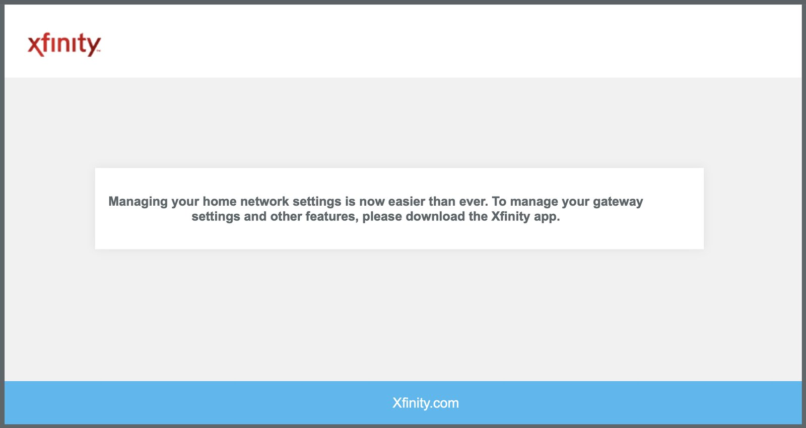

**WPA2 Personal and signal data (network name and MACs blurred)**

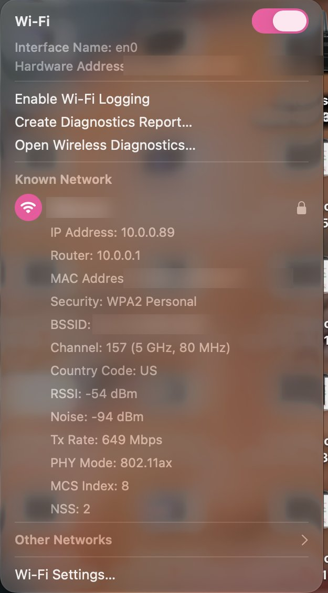

**`arp -a` device list (MACs blurred)**

**VM addressing behind the Mac**

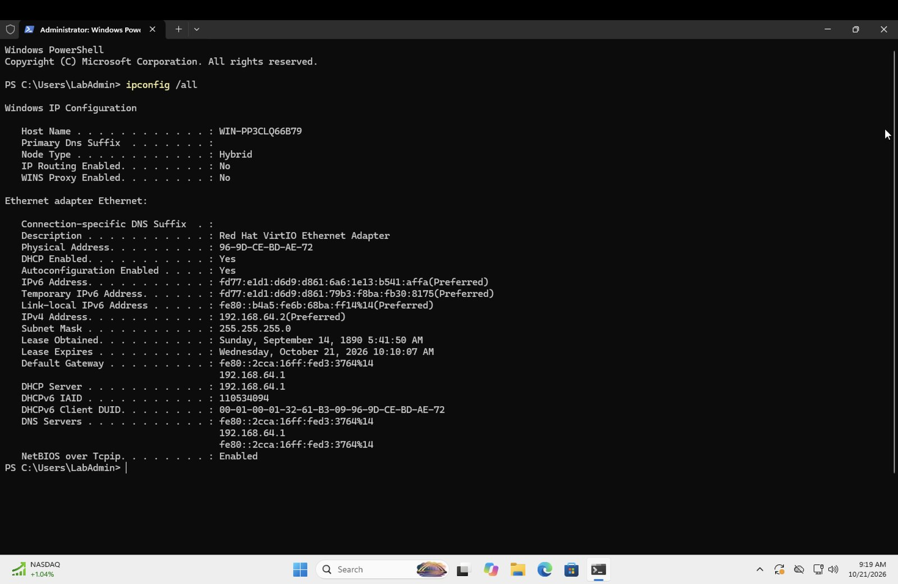

**Four ping tests, 0% loss**

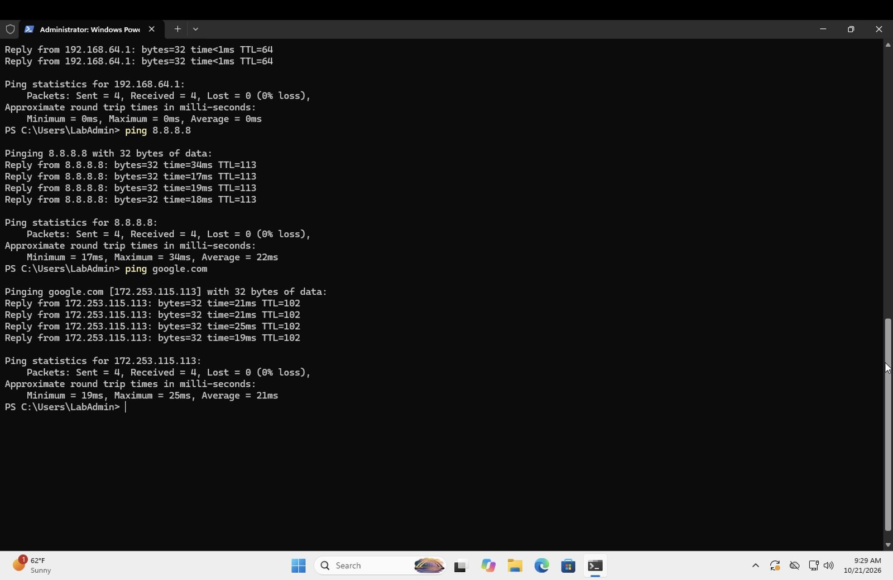

**26-hop trace**

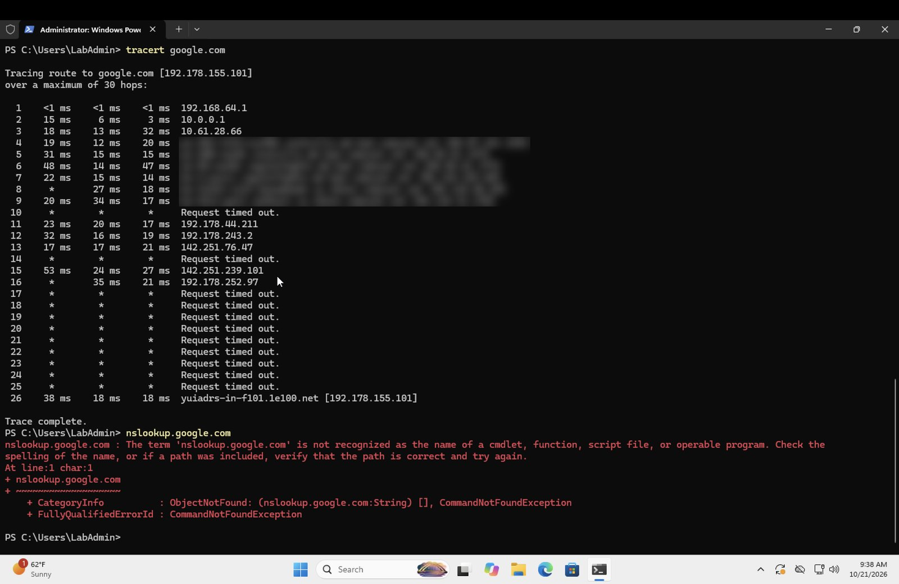

**DNS answer**

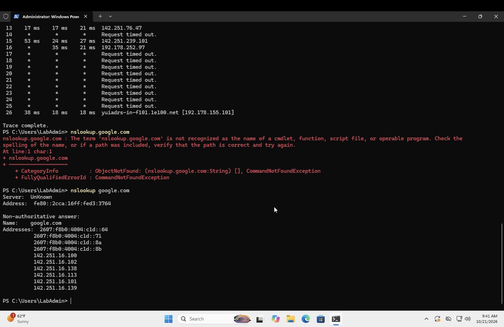

**Network broken and restored**

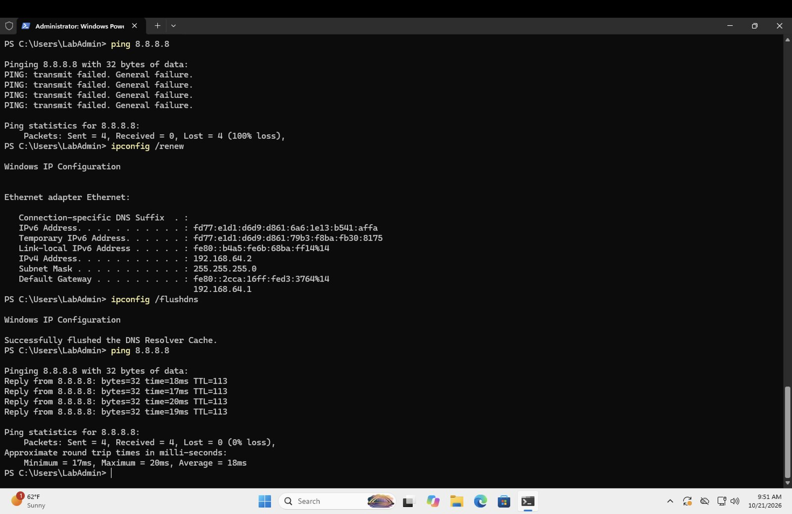

**220 sent, 0 received**

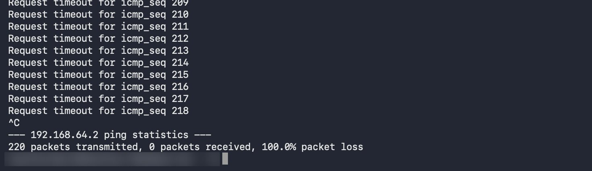

**Public profile active, inbound blocked**

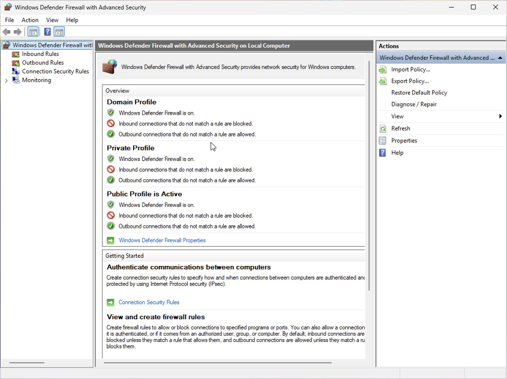

**Echo Request rules set to Yes**

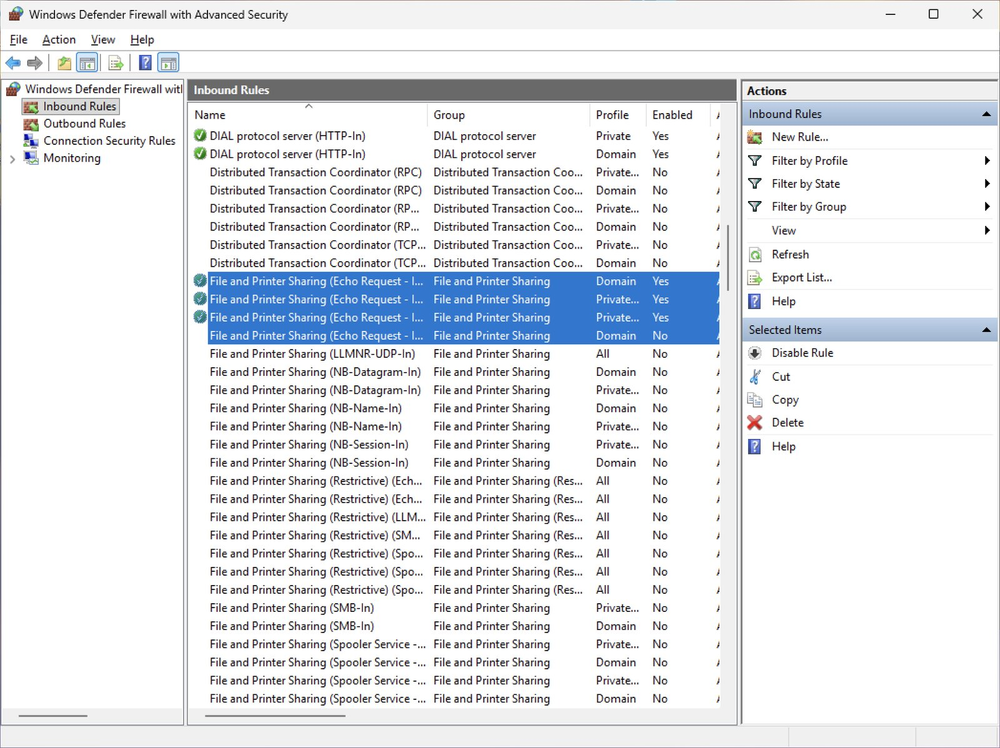

**19 sent, 19 received**

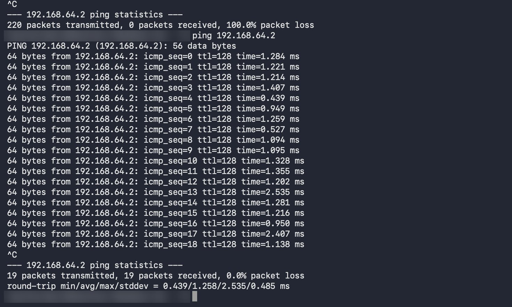

